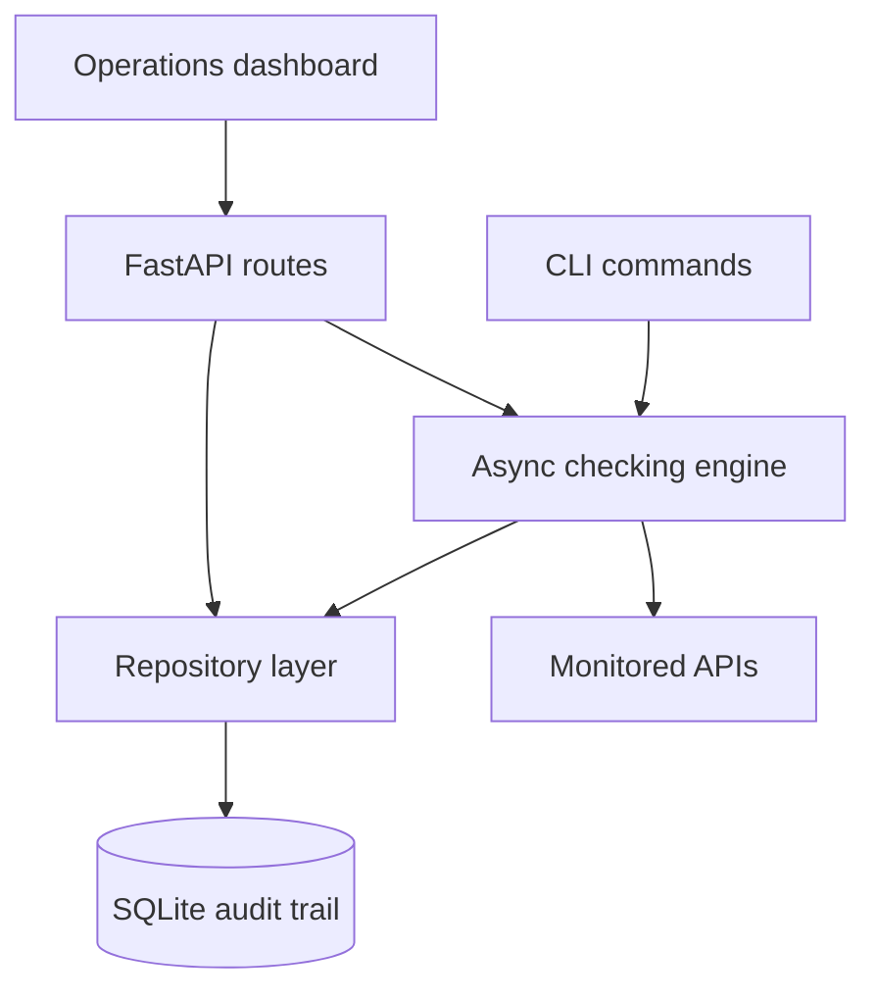

# PulseWatch — API Reliability Monitor

[](https://github.com/TheKhadaJhin/pulsewatch-api-monitor/actions/workflows/ci.yml)
[](https://www.python.org/)
[](https://fastapi.tiangolo.com/)
[](LICENSE)

PulseWatch is a lightweight backend service that monitors HTTP APIs, records every
check and turns the results into operational reliability metrics. It combines an
asynchronous checking engine, REST API, SQLite audit trail and responsive dashboard
in one deployable project.

The project focuses on **backend reliability and testable behavior**, not only CRUD:
bounded concurrency, per-service timeouts, selective retries with exponential
backoff, incident classification, input validation and safe defaults are all part of
the core design.

## What it demonstrates

- Asynchronous Python with `asyncio`, HTTPX and bounded concurrency
- REST API design and automatic OpenAPI documentation with FastAPI
- Retry strategy for timeouts, network errors, rate limits and server failures
- Persistent audit history and aggregate reliability metrics with SQLite
- Pydantic validation, explicit error contracts and dependency-friendly architecture
- API testing with mocked HTTP transports—tests never depend on the public internet
- Security-minded URL handling and non-root Docker execution
- Automated quality checks with pytest, coverage, Ruff and GitHub Actions
- A responsive, dependency-free operations dashboard

## Architecture



The HTTP client is injectable, so the same engine that performs real checks in
production can be tested deterministically through an in-memory mock transport.

## Quick start

Requirements: Python 3.11 or newer.

```bash
git clone https://github.com/TheKhadaJhin/pulsewatch-api-monitor.git
cd pulsewatch-api-monitor
python -m venv .venv
```

Activate the environment:

```bash
# Linux / macOS
source .venv/bin/activate

# Windows PowerShell
.venv\Scripts\Activate.ps1
```

Install and start the application:

```bash
pip install -e ".[dev]"
python -m app.cli init-db
uvicorn app.main:app --reload
```

Open the dashboard at [http://127.0.0.1:8000](http://127.0.0.1:8000) and the
interactive API documentation at
[http://127.0.0.1:8000/docs](http://127.0.0.1:8000/docs).

Optional demo flow:

```bash
python -m app.cli seed
python -m app.cli check
python -m app.cli summary --hours 24
```

## Docker

```bash
docker compose up --build
```

The compose configuration persists SQLite data in a named volume. The image includes
a health check and runs the application under a dedicated non-root user.

## API overview

| Method | Endpoint | Purpose |
| --- | --- | --- |
| `GET` | `/api/health` | Application and database readiness |
| `POST` | `/api/services` | Register an endpoint to monitor |
| `GET` | `/api/services` | List configured services |
| `PATCH` | `/api/services/{id}` | Update or disable a service |
| `DELETE` | `/api/services/{id}` | Delete a service and its audit history |
| `POST` | `/api/checks/run` | Check all or a selected group concurrently |
| `GET` | `/api/checks` | Query the latest check results |
| `GET` | `/api/summary` | Calculate uptime, incidents and latency metrics |

Ready-to-run examples are available in [`docs/requests.http`](docs/requests.http).

## Check behavior

Each service defines its HTTP method, expected status, timeout and retry count. A
check is healthy only when the final status exactly matches the configured status.
PulseWatch retries transient failures—timeouts, connection problems, HTTP `429` and
`5xx` responses—using exponential backoff. Deterministic client failures such as an
unexpected `404` are recorded immediately without unnecessary retries.

Results include:

- UTC timestamp
- HTTP status when available
- response latency
- number of attempts
- healthy/unhealthy classification
- normalized error type and concise diagnostic message

The summary endpoint uses a configurable time window and classifies the latest state
as `healthy`, `degraded`, `down` or `never_checked`.

## Tests and quality checks

```bash
ruff check .
pytest --cov=app --cov-report=term-missing
```

The suite covers CRUD contracts, validation, duplicate protection, selective retry
logic, timeout handling, private-target blocking, concurrency limits, metrics and
cascade deletion. HTTP behavior is simulated with `httpx.MockTransport`, keeping CI
fast and reproducible.

## Configuration

Copy `.env.example` values into your environment as needed:

| Variable | Default | Description |
| --- | --- | --- |
| `PULSEWATCH_DATABASE_PATH` | `data/pulsewatch.db` | SQLite database path |
| `PULSEWATCH_CHECK_CONCURRENCY` | `5` | Maximum simultaneous checks |
| `PULSEWATCH_RETRY_BACKOFF_SECONDS` | `0.2` | Base exponential backoff delay |
| `PULSEWATCH_DEGRADED_LATENCY_MS` | `750` | Slow-response classification threshold |
| `PULSEWATCH_ALLOW_PRIVATE_HOSTS` | `false` | Permit trusted private/LAN targets |

## Project structure

```text
app/
├── main.py          # FastAPI factory, middleware and routes
├── monitoring.py    # Concurrent HTTP checking and retry policy
├── repository.py    # Persistence and reliability aggregation
├── database.py      # SQLite lifecycle and schema
├── models.py        # Validated API contracts
├── cli.py           # Operational command-line interface
└── static/          # Responsive monitoring dashboard
tests/               # Deterministic unit and API tests
docs/                # Ready-to-run HTTP requests
.github/workflows/   # Continuous integration
```

## Security notes

PulseWatch does not store response bodies. URL credentials, localhost targets,
private hostnames and non-global IP literals are rejected by default. See
[`SECURITY.md`](SECURITY.md) for deployment considerations and the limits of hostname
validation.

## Author

**Mario Fuentes** — Computer Engineering · Python · FastAPI · SQL · Backend systems

- GitHub: [@TheKhadaJhin](https://github.com/TheKhadaJhin)
- English C1 · Spanish native

## License

Released under the [MIT License](LICENSE).
