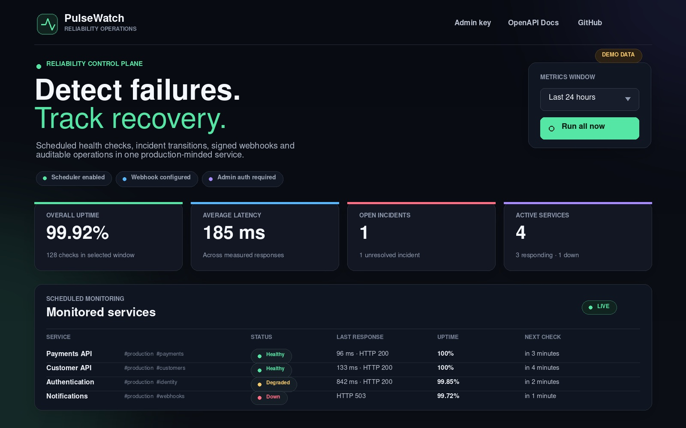
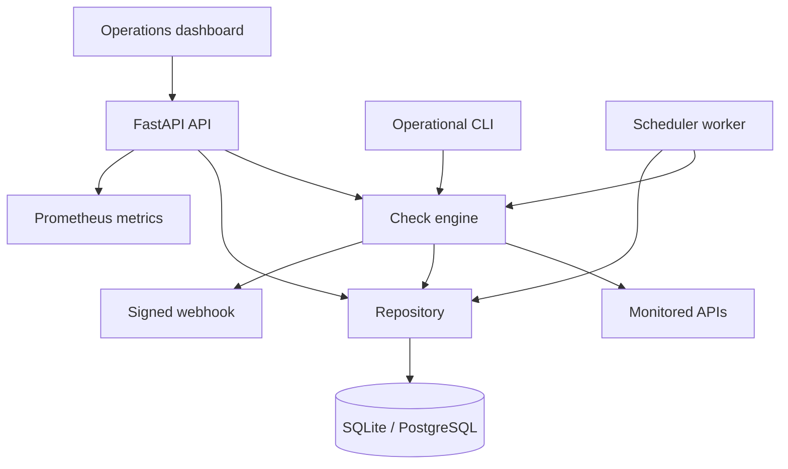
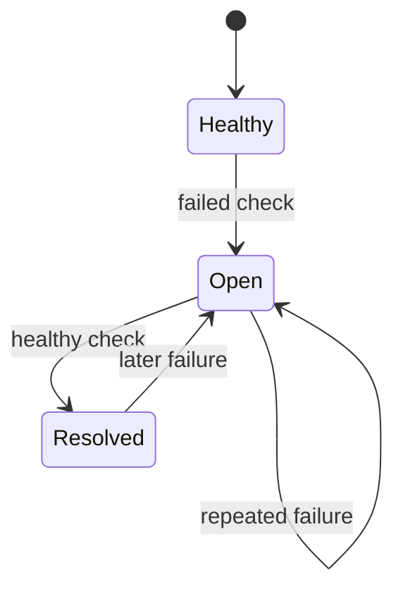

# PulseWatch — API Reliability Monitor

[](https://github.com/TheKhadaJhin/pulsewatch-api-monitor/actions/workflows/ci.yml)
[](https://github.com/TheKhadaJhin/pulsewatch-api-monitor/actions/workflows/security.yml)
[](https://github.com/TheKhadaJhin/pulsewatch-api-monitor/actions/workflows/codeql.yml)
[](#quality-gates)
[](https://www.python.org/)
[](https://fastapi.tiangolo.com/)
[](LICENSE)

PulseWatch is a production-minded API reliability platform. It schedules concurrent
HTTP health checks, applies selective retries, tracks incident lifecycles, sends
signed webhooks, exposes Prometheus metrics, and presents the result in a responsive
operations dashboard.

It is intentionally more than a CRUD demo: the project models failure, recovery,
operational safety, database evolution, and deployment boundaries—the parts that
make backend systems interesting in real work.

## Operations dashboard



The preview uses safe demonstration data to show healthy, degraded, and failed
service states without representing a live production environment.

## Why this project exists

Teams depend on APIs that can become slow, return an unexpected status, or stop
responding altogether. PulseWatch answers four practical questions:

1. Is each service healthy right now?
2. How reliable has it been during a selected time window?
3. When did an outage start and recover?
4. Can operators investigate and automate the response safely?

## Capability map

| Area | Implementation |
| --- | --- |
| Check engine | Async HTTPX requests, bounded concurrency, per-service timeouts |
| Resilience | Exponential backoff with jitter; retries only transient failures |
| Automation | Due-service scheduler, persistent heartbeat, intervals, and batch size |
| Incidents | Opens on first failure, accumulates failures, resolves on recovery |
| Alerting | Optional HMAC-SHA256 signed webhooks with retries and idempotency keys |
| Persistence | Async SQLAlchemy repository; SQLite locally and PostgreSQL in production |
| Schema evolution | Alembic migrations and a PostgreSQL migration smoke test |
| Security | Optional admin API key, SSRF-oriented target validation, secure headers |
| Observability | Prometheus metrics, request IDs, timing headers, structured JSON logs |
| Governance | Mutation audit log, notification history, configurable data retention |
| Delivery | Non-root/read-only containers, API/worker split, Compose health checks |
| Quality | 101 deterministic tests, 97% coverage, Ruff, mypy, Bandit, pip-audit, CodeQL |

## Architecture



The web API and scheduler can run as separate processes. That makes API replication
safe while keeping scheduled work in one worker. Both use the same repository and
database contracts.

### Incident lifecycle



Only transitions create notifications. Repeated failures update the current
incident instead of generating alert noise.

See [Architecture](docs/ARCHITECTURE.md) for component boundaries, data model,
request flow, retry policy, concurrency model, and architectural decisions.

## Quick start

Requirements: Python 3.11+ and Git.

```bash
git clone https://github.com/TheKhadaJhin/pulsewatch-api-monitor.git
cd pulsewatch-api-monitor
python -m venv .venv
```

Activate the virtual environment:

```bash
# Linux / macOS
source .venv/bin/activate

# Windows PowerShell
.venv\Scripts\Activate.ps1
```

Install, initialize, and run:

```bash
python -m pip install -e ".[dev]"
pulsewatch init-db
uvicorn app.main:app --reload
```

Then open:

- Dashboard: [http://127.0.0.1:8000](http://127.0.0.1:8000)
- Swagger UI: [http://127.0.0.1:8000/docs](http://127.0.0.1:8000/docs)
- ReDoc: [http://127.0.0.1:8000/redoc](http://127.0.0.1:8000/redoc)
- Prometheus metrics: [http://127.0.0.1:8000/metrics](http://127.0.0.1:8000/metrics)

Optional demo data:

```bash
pulsewatch seed
pulsewatch check
pulsewatch summary --hours 24
```

The dashboard works without an API key in the local default. To exercise production
authentication, generate and configure one:

```bash
pulsewatch generate-key
# Set the result as PULSEWATCH_ADMIN_API_KEY, then restart the app.
```

## Run the production-shaped stack

Docker Compose starts PostgreSQL, the API, and a dedicated scheduler worker:

```bash
cp .env.example .env
# Set PULSEWATCH_ADMIN_API_KEY and, optionally, webhook settings in .env.
docker compose up --build
```

The API container applies Alembic migrations before startup. PostgreSQL data is
stored in a named volume. The Compose password is a local-development default and
must be replaced outside a developer machine.

See [Deployment guide](docs/DEPLOYMENT.md) for production topology, migration
ownership, secrets, TLS, egress controls, backups, scaling, and a release checklist.
The [operations runbook](docs/RUNBOOK.md) covers first-response diagnosis.

## API overview

The public contract is versioned under `/api/v1`.

| Method | Endpoint | Auth | Purpose |
| --- | --- | --- | --- |
| `GET` | `/api/v1/health/live` | Public | Process liveness |
| `GET` | `/api/v1/health/ready` | Public | Database and schema readiness |
| `GET` | `/api/v1/config` | Public | Safe runtime capabilities |
| `POST` | `/api/v1/services` | Admin | Register a monitored endpoint |
| `GET` | `/api/v1/services` | Public | List and paginate services |
| `PATCH` | `/api/v1/services/{id}` | Admin | Update, pause, or reschedule |
| `DELETE` | `/api/v1/services/{id}` | Admin | Delete a service |
| `POST` | `/api/v1/checks/run` | Admin | Run all or selected checks |
| `GET` | `/api/v1/checks` | Public | Filter and paginate check history |
| `GET` | `/api/v1/summary` | Public | Uptime, incidents, and latency |
| `GET` | `/api/v1/incidents` | Public | Open/resolved incident history |
| `GET` | `/api/v1/operations/scheduler` | Public | Scheduler state |
| `POST` | `/api/v1/operations/scheduler/run` | Admin | Trigger one due-service cycle |
| `POST` | `/api/v1/operations/retention/run` | Admin | Remove expired checks |
| `GET` | `/api/v1/operations/audit` | Admin | Mutation audit trail |
| `GET` | `/api/v1/operations/notifications` | Admin | Webhook delivery history |
| `GET` | `/metrics` | Public* | Prometheus exposition |

\* Put `/metrics` behind network policy or reverse-proxy authentication in an
internet-facing deployment.

Ready-to-run examples are in [docs/requests.http](docs/requests.http).

## Check and retry semantics

Each service controls its method (`GET` or `HEAD`), expected status, timeout,
retry count, and schedule interval.

PulseWatch retries:

- timeouts and network errors;
- HTTP `429`;
- HTTP `5xx`.

It does not retry deterministic client responses such as an unexpected `404`.
Backoff is exponential with jitter, reducing synchronized retry storms. A result
records the status (when available), latency, attempt count, trigger, normalized
error, request ID, and UTC timestamp.

Redirects are recorded as responses but deliberately not followed; following an
operator-supplied public URL into a private network would weaken SSRF defenses.

## Configuration

All runtime configuration uses `PULSEWATCH_*` environment variables. The complete,
annotated template is [.env.example](.env.example).

| Variable | Default | Description |
| --- | --- | --- |
| `PULSEWATCH_DATABASE_URL` | SQLite URL | SQLAlchemy async database URL |
| `PULSEWATCH_ADMIN_API_KEY` | unset | Protects mutations and operational history |
| `PULSEWATCH_SCHEDULER_ENABLED` | `true` | Runs the in-process scheduler |
| `PULSEWATCH_CHECK_CONCURRENCY` | `5` | Maximum concurrent checks per batch |
| `PULSEWATCH_SCHEDULER_POLL_SECONDS` | `5` | Due-service polling interval |
| `PULSEWATCH_RETENTION_DAYS` | `30` | Check-result retention window |
| `PULSEWATCH_WEBHOOK_URL` | unset | Incident transition destination |
| `PULSEWATCH_WEBHOOK_SECRET` | unset | HMAC signing secret |
| `PULSEWATCH_ALLOW_PRIVATE_HOSTS` | `false` | Allows trusted LAN targets |
| `PULSEWATCH_LOG_JSON` | `false` | Emits machine-readable logs |
| `PULSEWATCH_CORS_ORIGINS` | unset | Explicit comma-separated origins |

Settings are typed, range-checked, and fail fast on invalid values.

## Observability

- Every response includes `X-Request-ID` and `Server-Timing`.
- Mutation and manual-operation records preserve actor and request ID.
- JSON logs include HTTP method, path, status, duration, and correlation ID.
- Prometheus metrics cover HTTP traffic, check outcomes and latency, incident
  transitions, webhook delivery, and scheduler cycles.
- Liveness and readiness are separate so an orchestrator can make correct decisions.
- Worker heartbeat is persisted, so API replicas report scheduler health across
  process boundaries and mark stale workers as stopped.

## Quality gates

The test suite performs no public network calls. HTTP behavior is injected through
`httpx.MockTransport`, while database tests use isolated SQLite files. CI also
applies Alembic to PostgreSQL and verifies a repository round trip.

```bash
ruff format --check .
ruff check .
mypy app
bandit -c pyproject.toml -r app
pytest --cov=app --cov-report=term-missing
pip-audit
```

Current local verification: **101 tests passed, 97.36% combined statement/branch
coverage**. CI rejects coverage below 90%.

GitHub automation also includes CodeQL, a weekly dependency/security scan, and
monthly Dependabot updates for Python and Actions.

## CLI

```text
pulsewatch init-db
pulsewatch seed
pulsewatch check
pulsewatch summary --hours 24
pulsewatch scheduler-once
pulsewatch worker
pulsewatch retention
pulsewatch generate-key
```

## Project structure

```text
app/
├── main.py              # Versioned API, middleware, lifecycle
├── monitoring.py        # Async checks, retries, concurrency
├── scheduler.py         # Due-service and retention worker
├── notifications.py     # Signed, retryable webhooks
├── repository.py        # Persistence, incidents, summaries, audit
├── db_models.py         # SQLAlchemy ORM schema
├── database.py          # Async engines and sessions
├── models.py            # Validated request/response contracts
├── security.py          # Admin auth and target safeguards
├── metrics.py           # Isolated Prometheus registry
├── cli.py               # Operational command line
└── static/              # Responsive operations dashboard
migrations/              # Alembic migration history
tests/                   # API, repository, scheduler, webhook, CLI tests
docs/                    # Architecture, deployment, webhook and interview guides
scripts/                 # CI integration probes
.github/                 # CI, security, CodeQL, release, contribution templates
```

## Deliberate limits

PulseWatch is a strong portfolio and small-team monitoring service, not a replacement
for a globally distributed commercial platform.

- The scheduler is intentionally single-worker; it does not yet use distributed
  leases.
- Authentication is one administrative API key, not user accounts or RBAC.
- Webhooks are the only alert channel; email, Slack, and escalation policies are
  downstream integrations.
- Hostname filtering reduces obvious SSRF risk but production still needs egress
  allowlists or a controlled proxy to address DNS rebinding.
- The service measures HTTP reachability and status; it does not run synthetic
  browser journeys or distributed regional probes.

These boundaries are documented because honest scope and a credible evolution path
are stronger engineering signals than pretending a portfolio system has unlimited
scale.

For a non-technical and technical explanation, interview demo script, expected
questions, and roadmap, see
[Guía para explicar PulseWatch](docs/EXPLICACION_ENTREVISTA_ES.md).

## Contributing and security

Read [CONTRIBUTING.md](CONTRIBUTING.md) before opening a pull request. Report
vulnerabilities according to [SECURITY.md](SECURITY.md), not in a public issue.
Notable changes are recorded in [CHANGELOG.md](CHANGELOG.md).

## Author

**Mario Fuentes** — Computer Engineering · Python · FastAPI · SQL · Backend systems

- GitHub: [@TheKhadaJhin](https://github.com/TheKhadaJhin)
- English C1 · Spanish native

## License

Released under the [MIT License](LICENSE).
