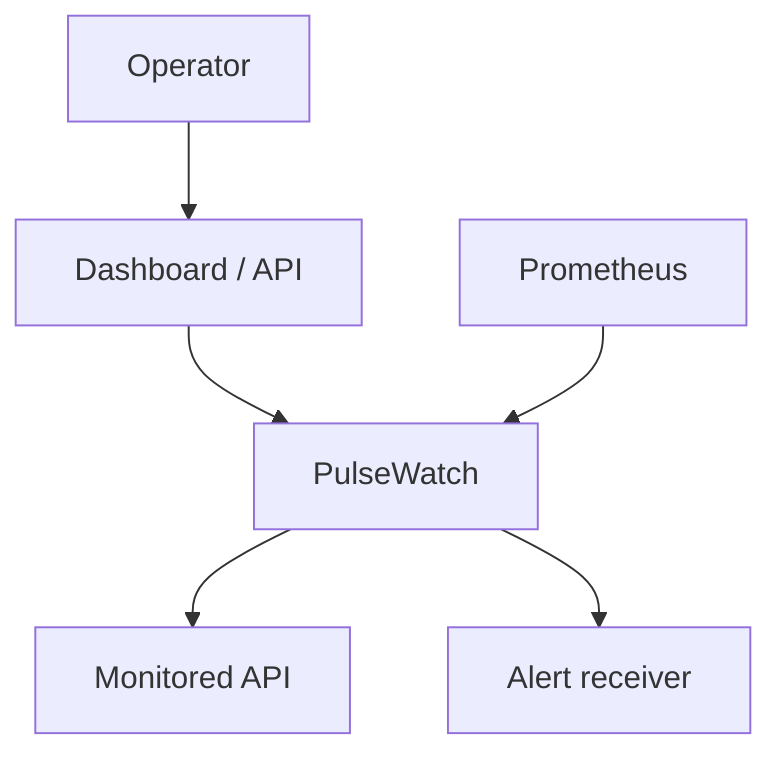
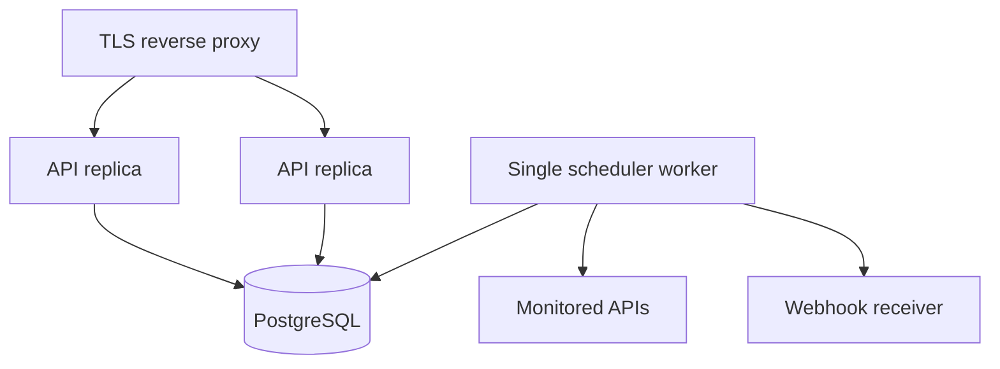
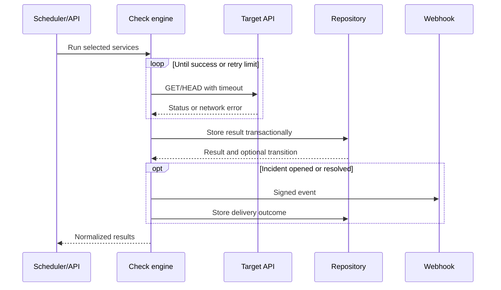
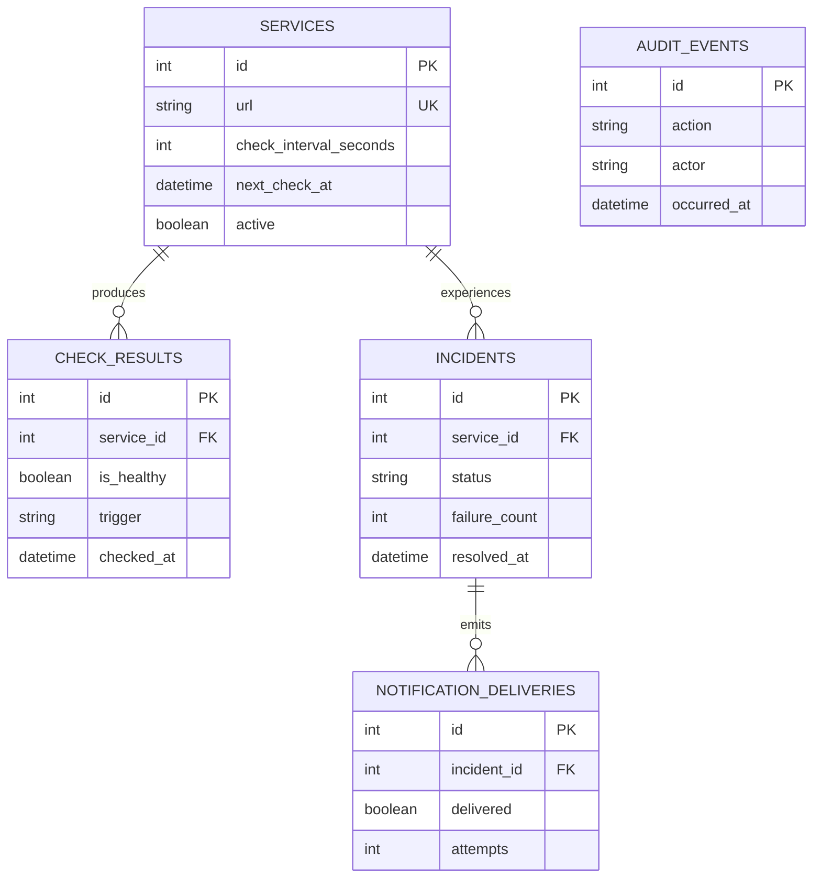

# PulseWatch architecture

## System context

PulseWatch is an active HTTP monitoring service. Operators register endpoints and
inspect reliability through the dashboard or versioned REST API. A scheduler selects
due services, the check engine performs outbound requests, and every result is
persisted for incident and reliability analysis.



## Runtime components

| Component | Responsibility | Does not own |
| --- | --- | --- |
| FastAPI application | HTTP contract, authentication, validation, middleware | Check policy or SQL |
| Scheduler | Finds due services, heartbeats, and triggers retention | HTTP implementation |
| Check engine | Concurrency, timeout, retry, result normalization | SQL queries |
| Incident manager | Implemented transactionally in the repository | Alert transport |
| Webhook notifier | Signing, idempotency, delivery retries | Incident creation |
| Repository | CRUD, incidents, audit, summaries, retention | HTTP concerns |
| Database adapter | Engine/session lifecycle and SQLite pragmas | Domain queries |
| Dashboard | Operator presentation and API-key entry | Business rules |

The dependency direction stays inward: routes and workers call the same application
services, which call the repository. HTTP transports are injectable, so tests execute
the real policy without touching the internet.

## Deployment topology



API replicas run with the scheduler disabled. Exactly one worker owns scheduled
checks. Manual checks can still be requested through the API. A future distributed
lease would allow multiple active workers safely; the current explicit single-worker
rule keeps behavior predictable.

## Check request flow



## Concurrency and retries

A batch uses one `asyncio.Semaphore` to cap active requests. Services run
concurrently up to the configured limit; retries for one service remain sequential.
A batch lock prevents two batches in the same process from overlapping.
The client streams only response headers and closes the response without downloading
the body, bounding memory use for status-oriented checks.

Retry classification:

| Outcome | Retry? | Reason |
| --- | --- | --- |
| Expected status | No | Successful final result |
| Unexpected `4xx` except `429` | No | Usually deterministic client/config error |
| `429` | Yes | Temporary rate limit |
| `5xx` | Yes | Temporary upstream failure |
| Timeout | Yes | May be transient |
| HTTPX network error | Yes | May be transient |
| Blocked target | No | Security policy failure |

Delay is exponential backoff plus jitter. The maximum number of attempts is
`retry_count + 1`, with the API model limiting retry count to three.

## Incident consistency

Result creation and incident mutation occur in one database transaction. The
repository locks the parent service row before inspecting its incident, and a
partial unique index enforces at most one open incident per service.

- First unhealthy result: create an open incident and return
  `incident_opened`.
- Additional unhealthy result: increment `failure_count` and update the last
  failure details.
- Healthy result while an incident is open: resolve it and return
  `incident_resolved`.
- Healthy result without an open incident: store the result with no transition.

Notifications happen after the transaction. Their outcome is stored separately, so a
failed alert never rolls back monitoring history.

## Data model



Audit events intentionally have no foreign key to mutable entities. Deleting a
service removes its operational checks, incidents, and deliveries through cascades,
while the independent audit trail still records that the deletion happened.

A singleton `scheduler_state` row stores worker heartbeat, cycle state, errors, and
executed-check count. It is independent of monitored services.

## Reliability summary

The repository calculates a time-window aggregate and a latest-result projection in
SQL. Each active service is classified as:

- `never_checked`: no result exists;
- `down`: latest result is unhealthy;
- `degraded`: latest result is healthy but latency exceeds the threshold;
- `healthy`: latest result is healthy and below the threshold.

Overall uptime is:

```math
uptime = \frac{healthy\ checks}{all\ checks} \times 100
```

This is check-based availability, not duration-weighted SLA calculation. That
distinction is documented rather than hidden.

`incidents_total` counts distinct incidents opened inside the selected window;
repeated failed checks do not inflate it. `open_incidents` counts currently open
incidents for active services.

## Scheduler semantics

Each service stores `next_check_at`. A cycle:

1. reads active services due at cycle start;
2. limits selection to the configured batch size;
3. runs them with trigger `scheduled`;
4. advances each checked service by its own interval;
5. runs retention when the retention timer is due;
6. records cycle status and Prometheus metrics.

A cycle catches and records operational errors so the long-running worker continues.
Overlapping calls return zero rather than duplicating checks.

The worker publishes a database heartbeat on a bounded interval and at cycle
transitions. API replicas read that shared state. If a heartbeat becomes stale, the
API reports the worker as stopped even if its final shutdown update never arrived.

## Observability model

| Signal | Examples |
| --- | --- |
| Metrics | HTTP count/duration, check outcomes/latency, incidents, webhooks, cycles |
| Logs | Request ID, method, path, status, duration; JSON option |
| Traces | Not implemented; request IDs provide local correlation |
| Health | Separate process liveness and database/schema readiness |
| Audit | Actor, action, entity, request ID, metadata |

Prometheus uses an application-local registry, avoiding duplicate collectors when
multiple app factories are created during tests.

## Security boundaries

Administrative mutations accept `X-API-Key` or `Authorization: Bearer`. Comparison
is constant-time. Public read routes enable a status-page use case; deployments that
need private status data should enforce authentication at the reverse proxy.

Target validation rejects URL credentials, non-HTTP schemes, localhost/private
hostnames, and non-global IP literals by default. It is a defense-in-depth control,
not a network sandbox. Production should restrict outbound network routes.

## Portability

SQLAlchemy models and queries support SQLite and PostgreSQL. SQLite provides a
zero-service developer experience; PostgreSQL is used by the production-shaped
Compose topology and CI integration job. Alembic is the production schema authority.

## Architecture decisions

- [ADR 0001: SQLite locally, PostgreSQL in production](adr/0001-database-portability.md)
- [ADR 0002: Separate single scheduler worker](adr/0002-scheduler-worker.md)
